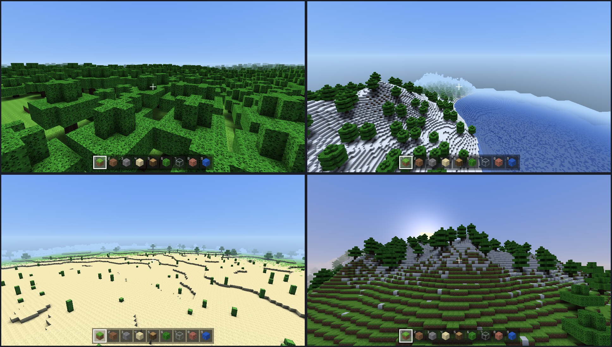
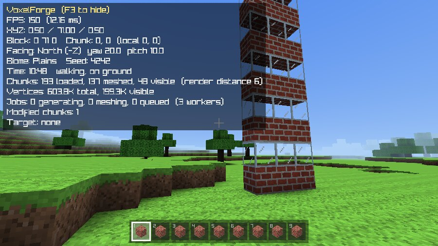

# VoxelForge

C++20과 raylib 5.5로 만든 마인크래프트 스타일 3D 복셀 샌드박스입니다.
무한히 이어지는 절차적 월드(바이옴 4종, 나무, 동굴, 광석), 그리디 메싱, 멀티스레드 청크 스트리밍,
프러스텀 컬링, 커스텀 GLSL 330 셰이더(안개·방향광·정점 AO·반투명 물), 낮과 밤, 저장/불러오기를 포함합니다.
리눅스에서 개발·검증하고 macOS(Apple Silicon)에서 그대로 빌드·실행되도록 만들었습니다.





> 위 이미지는 모두 클라우드 환경에서 Xvfb + Mesa 소프트웨어 렌더러로 `--screenshot` 옵션을 사용해 렌더링한 것입니다.

---

## macOS에서 빌드하기 (Apple Silicon)

```bash
# 1) 컴파일러 등 커맨드라인 도구 (처음 한 번)
xcode-select --install

# 2) CMake (Homebrew)
brew install cmake

# 3) 빌드 – raylib은 CMake FetchContent가 자동으로 내려받습니다(별도 설치 불필요)
git clone https://github.com/rxrnokd/VoxelForge.git
cd VoxelForge
cmake -S . -B build -DCMAKE_BUILD_TYPE=Release
cmake --build build --parallel

# 4) 실행
./build/voxelforge
```

- 처음 실행하면 무작위 시드로 새 월드가 생성되고, 종료할 때 `saves/world.vxf`에 저장됩니다.
- 같은 월드를 다시 실행하면 이어서 플레이합니다. 새 월드는 `--new`, 시드 지정은 `--seed 12345`.
- macOS는 OpenGL 3.3 core profile까지만 지원하므로 모든 셰이더는 GLSL 330으로 작성되어 있습니다.

### 리눅스

```bash
sudo apt-get install build-essential cmake git \
     libx11-dev libxrandr-dev libxinerama-dev libxcursor-dev libxi-dev libgl1-mesa-dev
cmake -S . -B build -DCMAKE_BUILD_TYPE=Release
cmake --build build --parallel
./build/voxelforge
```

### CMake 옵션

| 옵션 | 기본값 | 설명 |
|---|---|---|
| `VOXELFORGE_BUILD_GAME` | ON | 게임 실행 파일 (raylib 자동 다운로드) |
| `VOXELFORGE_BUILD_TESTS` | ON | doctest 단위 테스트 |
| `VOXELFORGE_WERROR` | OFF | 경고를 오류로 처리 (CI에서는 ON) |
| `VOXELFORGE_ASAN` | OFF | AddressSanitizer + UndefinedBehaviorSanitizer |
| `VOXELFORGE_TSAN` | OFF | ThreadSanitizer |

모든 프로젝트 타깃은 `-Wall -Wextra -Wpedantic`으로 컴파일되며 GCC 13 / Clang 18 / AppleClang에서 경고 0개입니다
(서드파티인 raylib 소스의 경고는 빌드 로그에서 숨깁니다).

---

## 조작키

| 키 | 동작 |
|---|---|
| `W` `A` `S` `D` | 이동 |
| 마우스 | 시점 조작 |
| `Space` | 점프 / 수영 시 위로 / 비행 중 상승 |
| `Left Ctrl` | 달리기 |
| `Left Shift` | 비행 중 하강 |
| `F` | 비행 모드 켜기/끄기 |
| 마우스 왼쪽 | 블록 부수기 (누르고 있으면 연속) |
| 마우스 오른쪽 | 블록 설치 (누르고 있으면 연속) |
| 마우스 가운데 | 바라보는 블록을 핫바로 가져오기 (pick block) |
| `1` – `9`, 마우스 휠 | 핫바 슬롯 선택 |
| `F3` | 디버그 화면 (FPS, 좌표, 청크, 불러온 청크 수, 정점 수, 바이옴 …) |
| `Esc` | 일시정지 메뉴 (마우스 감도, 렌더 거리, 시야각, 저장, 저장 후 종료) |
| `T` (누르고 있기) | 시간 빠르게 흐르기 |
| `F2` | 스크린샷 저장 |

블록 종류(19종): 잔디, 흙, 돌, 모래, 눈, 나무(원목), 나뭇잎, 물, 유리, 석탄 광석, 철 광석, 벽돌,
기반암, 나무판자, 조약돌, 금 광석, 다이아몬드 광석, 선인장, 자갈.

### 명령행 옵션

```
--seed N              새 월드의 시드          --world NAME     저장 슬롯 이름 (saves/NAME.vxf)
--new                 저장 파일을 무시하고 새 월드   --no-save        저장/설정 파일을 쓰지 않음
--render-distance N   렌더 거리(청크, 2~32)    --time T         시각 (0 일출, 0.25 정오, 0.5 일몰)
--pos X,Y,Z           시작 위치(눈 높이)       --yaw/--pitch    시작 방향(도)
--width W --height H  창 크기                --debug / --menu F3 화면 / 일시정지 메뉴를 연 채로 시작
--screenshot FILE     지정 프레임만큼 렌더링 후 PNG 저장하고 종료 (--frames N, 기본 10)
--benchmark [--quick] 청크 생성/메싱 성능 측정 후 종료 (창 없음)
```

---

## 프로젝트 구조

```
VoxelForge/
  CMakeLists.txt          단일 CMake 파일 (Linux / macOS 공통), raylib FetchContent
  cmake/EmbedShaders.cmake 셰이더를 빌드 시 C++ 헤더로 내장 → 실행 위치와 무관하게 동작
  src/
    main.cpp
    core/      Game(메인 루프), Settings, Input, DayNightCycle(시간), CommandLine, Benchmark, Math, Hash
    world/     Block, Chunk, World(스트리밍), Noise(펄린), TerrainGenerator, Biome
    render/    Mesher(그리디), ChunkMesh, TextureAtlas, Frustum, Renderer, GpuMesh, ShaderProgram, Sky
    physics/   AABB, Collision, Raycast(DDA)
    player/    Player(이동·물리), Inventory(핫바)
    threading/ ThreadPool, Task(move-only 작업), ConcurrentQueue
    io/        Rle, SaveFile, BinaryStream
    ui/        Hud(크로스헤어·핫바), DebugOverlay(F3), PauseMenu(ESC)
  shaders/     chunk.vs / chunk.fs / water.fs / sky.vs / sky.fs
  tests/       doctest 단위 테스트 (90개 테스트 케이스)
  .github/workflows/build.yml
```

엔진 코드(`voxelforge_engine` 정적 라이브러리)는 raylib에 의존하지 않습니다. 월드 생성, 메싱, 물리, 레이캐스트,
저장, 스레딩은 모두 GPU 없이 단위 테스트되고, raylib은 렌더링·입력·UI를 담당하는 실행 파일에만 링크됩니다.

---

## 핵심 알고리즘

### 1. 노이즈 기반 지형 생성

- **펄린 노이즈 직접 구현** (`world/Noise.cpp`): Ken Perlin의 improved noise(2002). 시드로 SplitMix64를 초기화해
  0~255 순열표를 Fisher–Yates로 섞고, 격자 꼭짓점마다 그래디언트를 골라 내적한 값을 `6t⁵−15t⁴+10t³`
  페이드 곡선으로 보간합니다. 2D(8방향 단위 그래디언트)와 3D(정육면체 모서리 12방향)를 지원합니다.
- **fBm(옥타브 합성)**: 주파수를 2배씩 높이고 진폭을 절반씩 줄인 노이즈를 여러 장 더해(옥타브마다 좌표를
  어긋나게 해 격자가 겹치지 않게 함) 큰 산맥부터 작은 굴곡까지 자연스러운 높이를 만듭니다.
  산맥에는 `1 − |noise|`를 제곱해 능선이 뾰족한 ridged multifractal을 씁니다.
- **바이옴(평원·사막·눈 덮인 산·숲)**: 온도·습도 노이즈가 기후 좌표를 만들고, 각 바이옴은 기후 공간의 한 점을
  가집니다. 거리의 가우시안으로 가중치를 구해 정규화하고 **바이옴별 높이 프로파일(기본 높이, 언덕 진폭, 산 진폭)을
  가중 평균**하므로 경계가 절벽이 아니라 완만한 경사로 이어집니다. 지표 블록은 가중치(4제곱으로 날카롭게 한 값)에
  비례해 열마다 해시로 골라 경계를 디더링합니다. 대륙 노이즈가 낮은 곳은 바다가 되고, 해수면 근처는 모래사장이 됩니다.
- **동굴**: 두 개의 3D 노이즈가 동시에 0에 가까운 곳(두 등위면의 교선)을 파내면 지렁이처럼 이어지는 터널이 되고,
  세 번째 노이즈의 높은 값은 깊은 곳의 큰 공동이 됩니다. 3D 노이즈는 4×8×4 격자에서만 계산하고 삼선형 보간해
  블록마다 노이즈를 계산하는 비용을 피합니다. 지표 입구는 별도 2D 마스크 영역에서만 뚫립니다.
- **광석**: 2×2×2 셀 단위로 해시를 굴려 높이 범위 안에서 군집을 만듭니다 — 석탄 y≤128, 철 y≤64, 금 y≤32, 다이아몬드 y≤16.
- **나무/선인장**: 5×5 셀마다 후보 위치 하나를 해시로 정하고, 그 위치의 바이옴에 따라 참나무·가문비나무·선인장을 심습니다.
- **재현성**: 모든 결정이 `(시드, 월드 좌표)`만의 순수 함수입니다. 그래서 같은 시드는 언제나 같은 월드를 만들고,
  청크 경계를 넘는 나무도 이웃 청크가 각자 같은 나무를 계산해 자기 영역 부분만 그리므로 생성 순서·스레드와 무관하게
  이어집니다(단위 테스트로 검증).

### 2. 그리디 메싱 (`render/Mesher.cpp`)

블록마다 정육면체를 그리면 청크 하나에 수십만 개의 면이 생깁니다. 메셔는 두 단계로 줄입니다.

1. **가려진 면 제거**: 이웃이 불투명 블록이면 그 면은 보이지 않으므로 만들지 않습니다(유리-유리, 물-물 경계도 제거).
   경계 면과 AO를 위해 메셔는 청크와 8개 이웃의 1블록 테두리까지 포함한 18×258×18 사본을 만들어 사용합니다.
2. **그리디 병합**: 6개 면 방향마다 청크를 한 층(slice)씩 훑으며 "보이는 면"의 2D 마스크를 만듭니다. 마스크 값은
   병합 조건을 담은 키(블록 종류 + 네 꼭짓점의 AO + 하늘빛 + 물 수면 여부)입니다. 아직 덮이지 않은 칸에서 시작해
   같은 키가 이어지는 만큼 가로로 넓히고(w), 그 폭 전체가 같은 키인 동안 세로로 늘려(h) 최대 직사각형을 하나의 쿼드로
   내보낸 뒤 그 영역을 지웁니다. AO가 같은 면끼리만 합치므로 조명은 병합 전과 똑같이 보입니다.

추가 최적화: 정점은 **8바이트**(1/16 블록 고정소수점 위치 3×u16 + 면/AO/타일/하늘빛을 담은 u16)이고,
텍스처 좌표는 저장하지 않고 프래그먼트 셰이더가 위치에서 계산합니다. 덕분에 여러 블록에 걸친 큰 쿼드에서도
텍스처가 블록 단위로 반복되고, 아틀라스 타일 간 번짐을 막기 위해 타일별 밉맵을 `texelFetch`로 직접 고릅니다.
AO 값에 따라 쿼드의 대각선 분할 방향을 바꿔(anisotropy fix) 어두운 줄무늬를 없앴습니다.

### 3. DDA 레이캐스트 (`physics/Raycast.cpp`)

Amanatides & Woo의 복셀 순회 알고리즘입니다. 광선이 다음 x/y/z 격자 경계를 지나는 거리 `tMax`와 한 칸을 지나는
거리 `tDelta`를 축마다 구해 두고, 매 단계 `tMax`가 가장 작은 축으로 한 칸 이동합니다. 광선이 통과하는 블록을
순서대로 **정확히 한 번씩** 방문하므로, 첫 번째로 만난 선택 가능한 블록이 바라보는 블록이 되고, 마지막으로 이동한
축이 진입한 면의 법선(= 블록을 설치할 방향)이 됩니다. 사거리(6블록)를 넘거나 월드 위·아래로 벗어나면 멈추고,
물은 통과합니다.

### 4. 프러스텀 컬링 (`render/Frustum.cpp`)

뷰-투영 행렬 `M`에서 클립 좌표 `c = M·v`가 `−w ≤ x, y, z ≤ w`일 때 화면 안이라는 점을 이용해, M의 4행에 1~3행을
더하거나 빼 6개의 평면(좌·우·하·상·근·원)을 바로 뽑습니다(Gribb & Hartmann). 청크마다 실제 기하가 있는 높이
범위로 줄인 AABB에서 각 평면 법선 방향으로 가장 먼 꼭짓점(positive vertex)이 평면 뒤에 있으면 그 청크는 그리지
않습니다. 월드는 카메라 기준 좌표로 렌더링하므로(카메라가 원점) 원점에서 멀리 떨어져도 float 정밀도 문제가 없습니다.

### 5. 멀티스레드 청크 스트리밍 (`world/World.cpp`, `threading/`)

- 메인 스레드가 플레이어 주변 원형 범위를 가까운 순서로 훑어 **생성 작업**과 **메싱 작업**을 워커 스레드 풀에 넣고,
  워커는 결과를 뮤텍스로 보호된 큐에 돌려줍니다. GPU 업로드(VBO 생성)는 메인 스레드에서만, 프레임당 개수를 제한해 수행합니다.
- **데이터 경쟁이 구조적으로 불가능**: 청크 블록 데이터는 발행된 뒤 불변(`std::shared_ptr<const Chunk>`)입니다.
  블록을 바꾸면 수정된 복사본으로 교체(copy-on-write)하므로 워커는 항상 불변 스냅샷만 읽습니다.
  언로드·재로드된 청크의 늦게 도착한 결과는 로드마다 다른 id로 걸러냅니다. 블록 편집으로 생긴 재메싱은 우선순위 큐로 먼저 처리합니다.
- ThreadSanitizer로 단위 테스트와 실제 게임 실행(스트리밍 + 렌더링)을 모두 검사해 경고 0개입니다.

### 6. 렌더링

- 불투명 패스(앞→뒤 정렬, 유리는 알파 컷아웃) → 블록 테두리 → 물 패스(뒤→앞 정렬, 블렌딩, 깊이 쓰기 끔).
- `chunk.fs`: 방향광(태양/달) + 면별 앰비언트 + 정점 AO + 하늘 노출(정점 단위, 높이맵 기반 → 동굴·처마 밑·나무 그늘이 어두움)
  + 수평 거리 안개(지평선 색과 일치시켜 렌더 거리 끝이 하늘에 녹아듦).
- `water.fs`: 텍셀 단위로 흐르는 텍스처, 물결로 흔든 법선의 정반사 하이라이트, 비스듬히 볼수록 불투명해지는 프레넬.
- `sky.fs`: 버텍스 버퍼 없이 `gl_VertexID`로 만든 전체 화면 삼각형에 하늘 그라데이션, 네모난 해·달, 해 주변 광륜, 밤하늘 별.
- 낮과 밤: 시각에 따라 태양 각도, 하늘·안개 색, 직사광·앰비언트 밝기, 일출/일몰 노을이 연속적으로 바뀝니다(기본 하루 10분).
- 텍스처는 이미지 파일 없이 코드로 생성한 16×16 픽셀 아트 22장을 하나의 아틀라스(256×32 + 밉맵)로 합쳐 씁니다.

### 7. 저장 (`io/`)

- 플레이어가 바꾼 청크만 저장합니다. 나머지는 시드로 다시 생성합니다.
- 형식: `"VXFG"` 매직 + 버전 + 페이로드 크기 + FNV-1a 체크섬 헤더, 이어서 시드·시각·플레이어 상태·핫바와
  청크 목록(좌표 + RLE 데이터). 모든 정수는 리틀 엔디언으로 바이트 단위 기록해 플랫폼과 무관합니다.
- RLE: `[반복 길이(LEB128 가변 길이 정수)][블록 id]` 쌍. 공기와 돌이 길게 이어지므로 64 KiB 청크가 수 KiB로 줄어듭니다.
  디코더는 잘린 입력·0 길이·버퍼 초과·알 수 없는 블록 id를 모두 거부합니다.
- 임시 파일에 쓴 뒤 rename하는 원자적 저장, 5분마다 자동 저장 + 종료 시 저장. 읽지 못한 저장 파일은 덮어쓰지 않습니다.
- 메모리에서 언로드된 수정 청크도 RLE로 압축해 보관합니다.

---

## 벤치마크

`./build/voxelforge --benchmark` (Release, 시드 1337, 16×16 청크 영역). 측정 환경은 개발용 클라우드 VM
(Intel Xeon 2.3 GHz, 4 vCPU → 워커 3개)이며, Apple Silicon 맥북에서는 이보다 빠릅니다.

| 항목 | 결과 |
|---|---|
| 청크 생성 (16×256×16, 바이옴·동굴·광석·나무 포함) | **0.31 ms / 청크** |
| 메싱 – 가려진 면 제거만 | 0.42 ms / 청크, 871 쿼드, 5,226 정점 |
| 메싱 – 그리디 | 0.40 ms / 청크, **582 쿼드, 3,494 정점** |
| 블록마다 정육면체(나이브) 대비 | 614,900 → 3,494 정점 (**0.57%만 남음**) |
| 가려진 면 제거 대비 그리디 | 정점 **33% 감소** (평평한 지형에서는 69%) |
| GPU 메모리 (8바이트 정점) | 청크당 약 27 KiB |
| 반경 12 청크(489개) 스트리밍 – 워커 1개 | 507 ms (965 청크/초) |
| 반경 12 청크(489개) 스트리밍 – 워커 3개 | 154 ms (3,186 청크/초, **3.3배**) |

그리디 병합률은 지형에 따라 다릅니다. 동굴 벽, 나뭇잎, 광석처럼 AO와 블록 종류가 자주 바뀌는 면은 합칠 수 없어서
실제 지형(동굴·나무 포함)에서는 33%, 동굴이 없던 초기 평지 지형에서는 69%가 줄었습니다.

---

## 검증 방법 (클라우드 / CI)

화면을 직접 볼 수 없는 환경에서도 검증할 수 있도록 만들었습니다.

```bash
ctest --test-dir build --output-on-failure        # 단위 테스트 90개 (doctest)
./build/voxelforge --benchmark                     # 성능 측정 (창 없이 실행)

# 헤드리스 렌더링: Xvfb + Mesa llvmpipe
LIBGL_ALWAYS_SOFTWARE=1 xvfb-run -a -s "-screen 0 1280x720x24" \
  ./build/voxelforge --screenshot shot.png --debug --pos 160,80,440 --yaw 160 --pitch -15 --time 0.15

# 새니타이저
cmake -S . -B build-asan -DVOXELFORGE_ASAN=ON && cmake --build build-asan && ./build-asan/voxelforge_tests
cmake -S . -B build-tsan -DVOXELFORGE_TSAN=ON && cmake --build build-tsan && ./build-tsan/voxelforge_tests
```

단위 테스트 범위: 노이즈(시드 재현성·범위·연속성), 청크/블록, 지형(시드 재현성, 생성 순서 무관, 바이옴 4종 등장,
경계의 완만함, 광석 깊이, 동굴 비율, 나무의 청크 경계 연속성), 메셔(면 제거, 그리디 병합, 감김 방향, AO, 하늘빛, 물),
텍스처 아틀라스, 레이캐스트, AABB 충돌·플레이어 물리, 스레드 풀, 프러스텀, 월드 스트리밍(로드/언로드, 편집,
copy-on-write, 저장 왕복), RLE, 저장 파일(손상·잘림·미래 버전 거부), 설정·명령행·낮밤 모델,
그리고 **안정 상태 프레임 시뮬레이션이 힙 할당을 0번 하는지**(operator new 카운팅).

GitHub Actions(`.github/workflows/build.yml`)는 push마다 다음을 실행합니다.

- `ubuntu-latest`, `macos-latest`: `-Werror` 빌드, 단위 테스트, 벤치마크 (리눅스는 Xvfb 스크린샷을 아티팩트로 업로드)
- ASan+UBSan / TSan: 단위 테스트 + 새니타이저 빌드로 실제 게임을 헤드리스 실행

## 성능·코드 품질 원칙

- RAII와 스마트 포인터만 사용합니다(`new`/`delete` 직접 사용 없음). GPU 자원(셰이더, 텍스처, VAO/VBO)도 move-only RAII 래퍼가 소유합니다.
- 매 프레임 동적 할당 없음: 보이는 청크 목록, 메시 버퍼(풀에서 재사용), 메셔 작업 버퍼(워커별 `thread_local`)를 재사용하고,
  UI 텍스트는 스택 버퍼에 `snprintf`합니다. 안정 상태 시뮬레이션의 할당 0회는 테스트로 확인합니다.
- 블록은 `uint8_t` 하나(청크당 64 KiB), 정점은 8바이트입니다.
- 플랫폼별 `#ifdef` 코드는 없습니다. 플랫폼 차이는 CMake(raylib이 macOS 프레임워크를 연결)와 GLSL 330 사용으로 흡수합니다.

## 알려진 제약

- 횃불 같은 블록 광원과 빛 전파는 없습니다(하늘 노출 기반의 간이 그림자만 있음).
- 물은 흐르지 않는 정적인 블록입니다.
- 레티나 디스플레이에서는 논리 해상도로 렌더링합니다(raylib `FLAG_WINDOW_HIGHDPI` 미사용).
